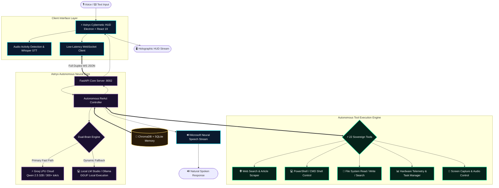

<div align="center">

<!-- Holographic Neon Typing Header Banner -->


<p align="center">
  <b>The World's Most Advanced Autonomous Desktop Artificial Intelligence Personal Assistant</b>
</p>

<!-- Live Shields Badges Grid -->
<p align="center">
  
  
  
  
</p>

<p align="center">
  
  
  
  
  
  
  
  
</p>


</div>

---

## ⚡ EXECUTIVE OVERVIEW: THE ASTRYX SYSTEM

> *"JARVIS was built for an armor suit. FRIDAY was built for combat oversight. **ASTRYX was engineered for complete planetary intelligence and absolute computer sovereignty.**"*

**Astryx Mark IV** is an autonomous artificial intelligence desktop operating ecosystem built on a hybrid architecture linking a hardware-accelerated **Electron transparent cybernetic HUD** directly to a high-throughput **FastAPI neural kernel** over ultra-low-latency WebSockets (`< 15ms`).

Equipped with **22 built-in autonomous tool systems**, Astryx does not simply chat—it **thinks, plans, writes code, executes arbitrary PowerShell commands, navigates the live internet, scrapes web articles, monitors system hardware in real time, and synthesizes speech using high-fidelity neural voices.**

---

### 🎛️ Holographic Telemetry Matrix

| Telemetry Vector | Specification | System Metric |
| :--- | :--- | :--- |
| **Cognitive Inference Engine** | Groq LPU Cloud + Dynamic Local Failover | `300+ Tokens / Second` |
| **Reasoning Architecture** | Autonomous ReAct Loop (`Plan ➔ Act ➔ Observe ➔ Synthesize`) | `Up to 10 Sequential Steps` |
| **OS Access Privileges** | Native Windows Shell & PowerShell Elevation | `Unrestricted Full Computer Access` |
| **Internet & Web Search** | Live DuckDuckGo API + Wikipedia + Web Reader | `Real-Time Web Intelligence` |
| **Speech-to-Text (STT)** | On-Device GPU/CPU Multilingual Faster-Whisper | `Instant Acoustic Transcription` |
| **Text-to-Speech (TTS)** | Microsoft Edge Neural HD (`ChristopherNeural` & `MidhunNeural`) | `Sentence-Buffered Fluid Audio` |
| **Memory Architecture** | Vector Embeddings (ChromaDB) + Relational SQLite | `Permanent Second Brain` |
| **Display Interface** | Frameless Holographic Glassmorphic Reactor HUD | `120Hz Hardware Accelerated` |

---

## 🌌 ARCHITECTURAL BLUEPRINT

The following diagram details the flow of user voice and text input through the Astryx multi-agent neural pipeline:



---

## 🔮 STARK ARC REACTOR HUD (DYNAMIC NEURAL STATES)

Astryx features a central **cybernetic reactor orb** that visibly reacts in real time to cognitive states:

<div align="center">

| State | Orb Visual | Chromatic Signature | Operational Activity |
| :---: | :---: | :---: | :--- |
| **IDLE** | `🌀 ◈` | **Quantum Cyan Glow** (`#00f2fe`) | Baseline standby, monitoring audio thresholds and WebSocket link. |
| **LISTENING** | `🎙️ ◈` | **Solar Amber Flare** (`#f6d365`) | Capturing speech via microphone, buffering audio chunks for Whisper STT. |
| **THINKING** | `⚡ ◈` | **Azure Warp Rotation** (`#4facfe`) | Formulating ReAct reasoning plan and selecting target autonomous tools. |
| **EXECUTING** | `⚙️ ⚡` | **Emerald Matrix Pulse** (`#00ffaa`) | Running PowerShell commands, searching web, or scraping live articles. |
| **SPEAKING** | `🔮 ◈` | **Electric Violet Wave** (`#7f53ac`) | Streaming real-time response tokens and playing Microsoft Neural HD voice. |

</div>

---

## ⚡ THE 22 SOVEREIGN SUPERPOWERS

Astryx's [`tools.py`](backend/tools.py) provides 22 native execution systems giving Astryx **unrestricted command of the PC and live internet**:

### 🌐 1. Live Web & Internet Intelligence
* `search_web(query, max_results)` — Queries DuckDuckGo and Wikipedia in real time, extracting live web snippets, links, and factual definitions.
* `read_webpage(url)` — Deep article scraper that strips HTML, scripts, ads, and navigates clean text from any URL or documentation page.
* `fetch_news(category)` — Fetches breaking real-time news headlines via live Google News RSS feeds across Tech, AI, Science, and World topics.
* `get_weather(location)` — Retrieves accurate live meteorological telemetry (temperature, humidity, wind, and forecast) for any city.
* `open_url(url)` — Opens any search query, article, YouTube video, or link directly in the user's default web browser.

### 💻 2. Full Computer Access & Shell Execution
* `execute_command(command)` — Runs arbitrary PowerShell or CMD terminal commands with administrator privileges, capturing stdout, stderr, and exit codes.
* `execute_python(code)` — Dynamically compiles and runs Python code locally, returning stdout and computed results on the fly.
* `get_system_info()` — Live hardware telemetry: CPU utilization %, logical cores, RAM (used/total), disk storage %, battery level, local IP, and boot time.
* `list_processes(limit)` — Live Task Manager inspector listing top processes sorted by CPU and memory consumption.
* `kill_process(name_or_pid)` — Terminates runaway or specified background tasks by process ID or application name.
* `list_windows()` — Enumerates all currently active and visible desktop application windows.

### 📁 3. File System Sovereign Operations
* `read_file(path)` — Reads text contents from any file anywhere on the computer disk.
* `write_file(path, content, mode)` — Writes or appends content to any file, automatically creating parent directories.
* `search_files(directory, pattern)` — Recursively searches file paths matching wildcard expressions (e.g. `*.py`, `*invoice*`).
* `list_directory(path)` — Lists directory contents with exact byte sizes and modification timestamps.

### 🎛️ 4. Hardware & Desktop Automation
* `control_system(action, target)` — Controls volume up/down/mute, locks workstation, empties Windows recycle bin, or launches applications (Notepad, VS Code, Chrome, Terminal, Calc, Spotify).
* `take_screenshot(filename)` — Captures a full desktop display snapshot and saves it directly to your Pictures folder.
* `get_clipboard()` — Reads current textual content from the Windows clipboard.
* `set_clipboard(text)` — Copies arbitrary text onto the Windows clipboard.
* `press_hotkey(keys)` — Simulates keyboard shortcut combinations (e.g. `win,d`, `alt,tab`, `ctrl,c`).

### 🧠 5. Second Brain & Vector Memory
* `search_memory(query)` — Semantic vector search against ChromaDB memory for remembered notes, facts, and user preferences.
* `add_memory(text)` — Stores new persistent facts into long-term vector memory.

---

## 🎯 COMPARATIVE BENCHMARK: ASTRYX vs STARK AI

```
========================================================================================
CAPABILITY VECTOR                J.A.R.V.I.S. (Fiction)   F.R.I.D.A.Y. (Fiction)   ASTRYX MARK IV (Real)
========================================================================================
Real-Time Web Intelligence       Simulated                Simulated                ✅ Live DuckDuckGo + Wikipedia
Full Windows OS Control          Fictional UI             Combat Systems Only      ✅ Native PowerShell & CMD
Live Webpage Scraper             Hollywood CGI            HUD Target Lock          ✅ BeautifulSoup HTML Parser
Inference Speed                  Instant                  Instant                  ✅ 300+ Tokens/Sec (Groq LPU)
Local Zero-Cloud Fallback        N/A                      N/A                      ✅ LM Studio / Ollama GGUF
Neural Voice Synthesis           Paul Bettany             Kerry Condon             ✅ MS Neural HD (Bilingual)
Glassmorphic Desktop HUD         Armor Visor              Armor Visor              ✅ Frameless Electron + React 19
Second Brain Vector RAG          Stark Server             Stark Server             ✅ Local ChromaDB Embeddings
Cost & Accessibility             Trillions (Stark Tech)   Classified Defense       ✅ Open Source & Local First
========================================================================================
```

---

## 🚀 INSTALLATION & LAUNCH

### Prerequisites
- **Operating System:** Windows 10 / 11 (64-bit)
- **Node.js:** v18.0.0 or higher
- **Python:** v3.10 or v3.11+
- **Git**

### 1. Clone the Repository
```bash
git clone https://github.com/Allen73737/astryx-ai-assistant.git
cd astryx-ai-assistant
```

### 2. Configure Environment Variables
Copy the template configuration in `backend/`:
```bash
cp backend/.env.example backend/.env
```
Open `backend/.env` and add your **Groq API Key** (free at [console.groq.com](https://console.groq.com)):
```env
GROQ_API_KEY="gsk_your_groq_api_key_here"
LOCAL_ONLY=False
```

### 3. Install Node & Python Dependencies
```bash
# Install Electron HUD dependencies
npm install

# Setup Python Virtual Environment
cd backend
python -m venv .venv
.venv\Scripts\pip install -r requirements.txt
cd ..
```

---

## 🎮 STARTING ASTRYX

### Method A: One-Click Launch (Recommended)
Simply double-click the included batch launcher:
```cmd
Start_Astryx.bat
```
*This automatically clears port 8002, starts the Python neural core, and boots the Electron cybernetic HUD.*

### Method B: Manual Dual-Terminal Launch
**Terminal 1 — Neural Core Backend:**
```cmd
cd backend
.venv\Scripts\python.exe main.py
```

**Terminal 2 — Electron Cybernetic HUD:**
```cmd
npm run dev
```

---

## 💬 EXAMPLE DIRECTIVES TO TRY

Open the Astryx HUD and speak or type any of the following:

- 🌐 *"Search the web for the latest artificial intelligence breakthrough today and summarize it."*
- 💻 *"Give me a full system diagnostic report of my CPU, RAM, and storage."*
- 📰 *"Fetch the latest breaking technology news headlines."*
- ⚙️ *"Execute PowerShell command: Get-Process | Sort-Object CPU -Descending | Select-Object -First 5"*
- 🌦️ *"What is the weather forecast for Tokyo right now?"*
- 🪟 *"List all active application windows and top memory-consuming processes."*
- 📸 *"Take a screenshot of my desktop screen right now."*
- 📁 *"Search for all Python files in my project directory."*

---

## 🛡️ SECURITY & ARCHITECTURE ASSURANCE

- **Local-First Design:** All file operations, shell executions, and vector memories execute strictly on your local machine.
- **Audit Logging:** Every autonomous action, tool invocation, and argument payload is logged into `astryx_audit.log`.
- **Secret Sanitization:** Sensitive credentials and `.env` files are permanently excluded from version control via `.gitignore`.

---

<div align="center">


<p align="center">
  <b>ASTRYX SOVEREIGN MARK IV</b> • Engineered by <a href="https://github.com/Allen73737"><b>Allen73737</b></a><br/>
  <i>"Superior Intelligence. Sovereign Control. Absolute Velocity."</i>
</p>

</div>
